# Data Exploration with Alluvial Plots

## Introduction

Alluvial plots are a form of [sankey
diagrams](https://en.wikipedia.org/wiki/Sankey_diagram) that are a great
tool for exploring categorical data. They group categorical data into
flows that can easily be traced in the diagram. Other than sankey
diagrams they are constrained to x-y dimensions, however their graphical
grammar is a bit more complex then that of a regular x-y plot. The
[`ggalluvial`](http://corybrunson.github.io/ggalluvial/) package made a
great job of translating that grammar into ggplot2 syntax and gives you
many option to tweak the appearance of a plot, nevertheless there still
remains a multilayered complexity that makes it difficult to use
`ggalluvial` for explorative data analysis. `easyalluvial` provides a
simple interface to this package that allows you to put out a decent
alluvial from any dataframe where data is stored in either long or wide
format while automatically binning continuous data. It is meant to allow
a quick visualisation of entire dataframes similar to the visualisations
created by the [`tabplot`](https://github.com/mtennekes/tabplot) package
providing different colouring options which give it the flexibility
needed for data exploration.

## Wide Format

### Sample data

``` r

suppressPackageStartupMessages( require(easyalluvial) )
suppressPackageStartupMessages( require(tibble) )
suppressPackageStartupMessages( require(dplyr) )
suppressPackageStartupMessages( require(ggplot2) )
suppressPackageStartupMessages( require(forcats) )
suppressPackageStartupMessages( require(purrr) )
```

``` r

data_wide = as_tibble(mtcars)
categoricals = c('cyl', 'vs', 'am', 'gear', 'carb')
numericals = c('mpg', 'cyl', 'disp', 'hp', 'drat', 'wt', 'qsec')

data_wide = data_wide %>%
  mutate_at( vars(categoricals), as.factor ) %>%
  mutate( car_id = row_number() )

knitr::kable( head(data_wide) )
```

|  mpg | cyl | disp |  hp | drat |    wt |  qsec | vs  | am  | gear | carb | car_id |
|-----:|:----|-----:|----:|-----:|------:|------:|:----|:----|:-----|:-----|-------:|
| 21.0 | 6   |  160 | 110 | 3.90 | 2.620 | 16.46 | 0   | 1   | 4    | 4    |      1 |
| 21.0 | 6   |  160 | 110 | 3.90 | 2.875 | 17.02 | 0   | 1   | 4    | 4    |      2 |
| 22.8 | 4   |  108 |  93 | 3.85 | 2.320 | 18.61 | 1   | 1   | 4    | 1    |      3 |
| 21.4 | 6   |  258 | 110 | 3.08 | 3.215 | 19.44 | 1   | 0   | 3    | 1    |      4 |
| 18.7 | 8   |  360 | 175 | 3.15 | 3.440 | 17.02 | 0   | 0   | 3    | 2    |      5 |
| 18.1 | 6   |  225 | 105 | 2.76 | 3.460 | 20.22 | 1   | 0   | 3    | 1    |      6 |

### alluvial_wide()

#### Binning of Numerical Variables

This function produces a simple alluvial plot of the given dataframe.
Numerical variables are centered, scaled and yeo johnson transformed
(transformed to resemble more of a normal distribution) by
[`easyalluvial::manip_bin_numerics()`](https://erblast.github.io/easyalluvial/reference/manip_bin_numerics.md).
Outliers as defined by the boxplot criteria ( see documentation for
[`grDevices::boxplot.stats()`](https://rdrr.io/r/grDevices/boxplot.stats.html))
are stunted to to the min and max values that are defined by the
whiskers of the box plot. The so transformed numeric variables are then
cut into 5 (default) equally ranged bins which are labeled ‘LL’
(low-low), ‘ML’ (medium-low), ‘M’ (medium), ‘MH’ (medium-high), HH
(high-high) by default.

``` r

alluvial_wide(data_wide
              , bins = 5 # Default
              , bin_labels = c('LL','ML','M','MH','HH') # Default
              , fill_by = 'all_flows'
              )
```

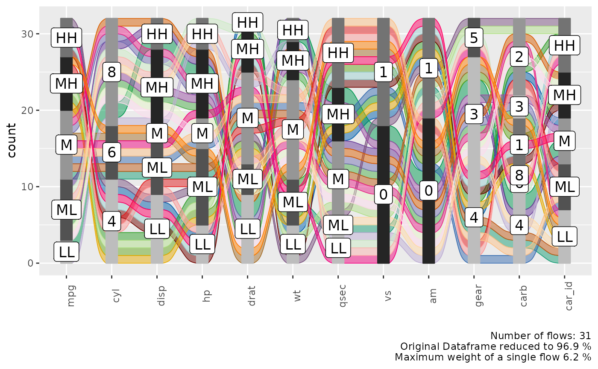

#### Alluvial Plot Organisation

Each group of stacked bars represents a variable while the size of each
segment represents how many observations in the dataframe belong to that
level matching the segment label. The colored flows between the bar
stack represent a group of observations that match the value for each
variable indicated by the flow. The thickness of the flow indicates how
many observations belong to that group.

We see that each flow has more or less the same thickness and the
statistical information in the plot caption tells us that we have 30
flows in total for 32 observations in the dataframe. Which means that
almost each observation is unique in its combination of variable values.

#### Reduce the Number of Variables

In order to reduce the complexity we can use a helper function
[`plot_condensation()`](https://erblast.github.io/easyalluvial/reference/plot_condensation.md)
to get an idea which variables we want to include in our alluvial plot.
Lets say we are especially interested in the `mpg` (miles per gallon)
variable and how it relates to the other variables. `plot_condensation`
will look for other variables it can combine `mpg` with while trying to
condense the data frame to a minimum.

``` r

plot_condensation(data_wide, first = mpg)
```

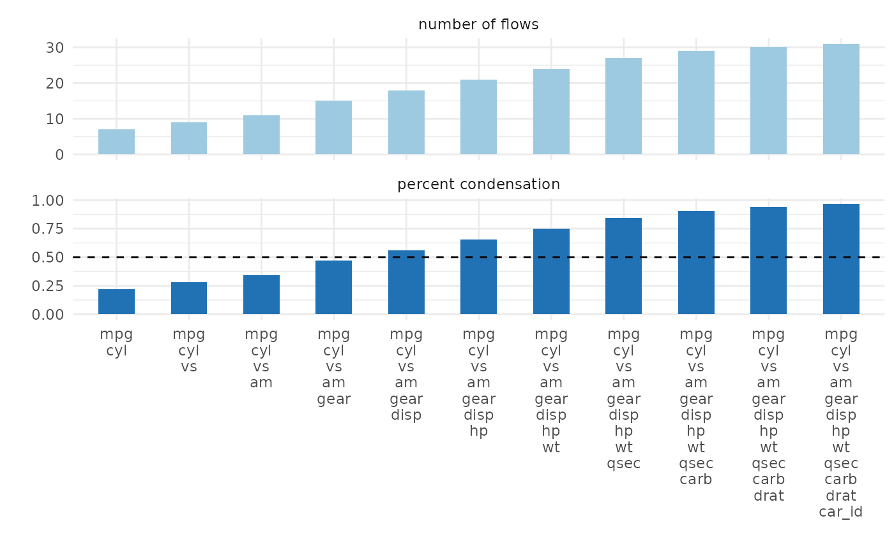

In general we want to condense the dataframe to 50% or less we might get
a meaningful alluvial when looking at `mpg, cyl, vs, am` in that order.

``` r

alluvial_wide( select(data_wide, mpg, cyl, vs, am), fill_by = 'first_variable' )
```

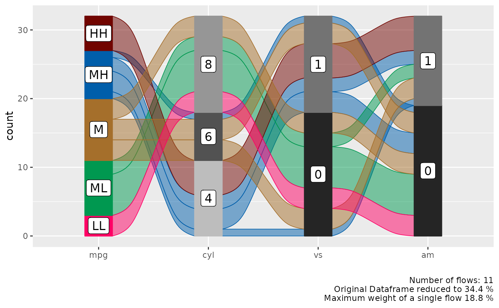

#### Reorder Levels

We can see a clear pattern in the flows now, especially now that we have
colored the flows by the `mpg` variable. However some of the flows are
unnecessarily criss-crossing. We can improve this by changing the order
of the levels of the `cyl` variable.

``` r

alluvial_wide( select(data_wide, mpg, cyl, vs, am)
               , fill_by = 'first_variable'
               , order_levels = c('8','6','4') )
```


If levels of several variables have levels of the same name we cannot
order them individually per variable, this is a design choice (see
documentation of
[`alluvial_wide()`](https://erblast.github.io/easyalluvial/reference/alluvial_wide.md)
). If we want to reorder them we need to assign individual level names
first.

``` r

p_unordered = alluvial_wide( select(data_wide, mpg, disp, hp)
                              , fill_by = 'first_variable' ) +
  labs( title = 'Unordered', caption = '\n\n' )

bin_labels = c('mpg_LL','mpg_LM','mpg_M','mpg_MH','mpg_HH')

p_ordered = data_wide %>%
  mutate( mpg = manip_bin_numerics(mpg, bin_labels = bin_labels)
          , mpg = fct_rev(mpg) ) %>%
  select( mpg, disp, hp) %>%
  alluvial_wide() +
  labs( title = 'Ordered')

gridExtra::grid.arrange( p_unordered, p_ordered, nrow = 1 )
```

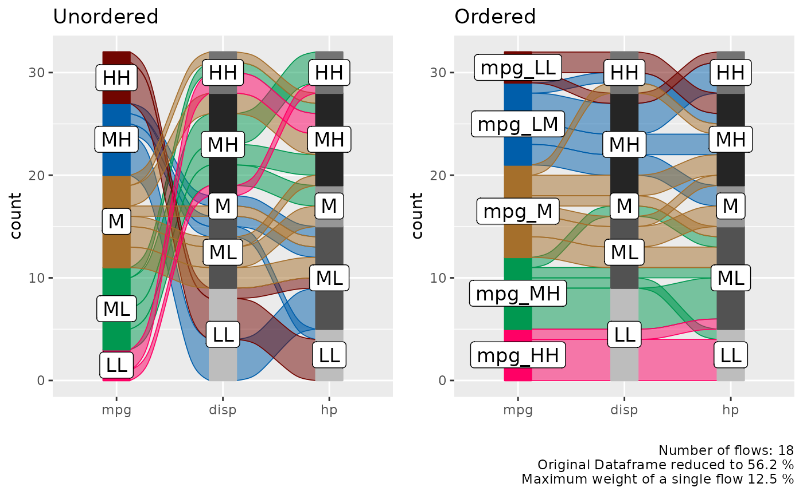

## Long Format

In certain cases we might want to start with a dataframe that is already
in long format, this is mostly the case for time-series data where we
want to track a categorical value over different time periods.

### Sample Data

``` r

monthly_flights = nycflights13::flights %>%
  group_by(month, tailnum, origin, dest, carrier) %>%
  summarise() %>%
  group_by( tailnum, origin, dest, carrier) %>%
  count() %>%
  filter( n == 12 ) %>%
  select( - n ) %>%
  left_join( nycflights13::flights ) %>%
  .[complete.cases(.), ] %>%
  ungroup() %>%
  mutate( flight_id = pmap_chr(list(tailnum, origin, dest, carrier), paste )
          , qu = cut(month, 4)) %>%
  group_by(flight_id, carrier, origin, dest, qu ) %>%
  summarise( mean_arr_delay = mean(arr_delay) ) %>%
  ungroup() %>%
  mutate( mean_arr_delay = ifelse( mean_arr_delay < 10, 'on_time', 'late' ) )
```

    ## `summarise()` has regrouped the output.
    ## Joining with `by = join_by(tailnum, origin, dest, carrier)`
    ## `summarise()` has regrouped the output.
    ## ℹ Summaries were computed grouped by month, tailnum, origin, dest, and carrier.
    ## ℹ Output is grouped by month, tailnum, origin, and dest.
    ## ℹ Use `summarise(.groups = "drop_last")` to silence this message.
    ## ℹ Use `summarise(.by = c(month, tailnum, origin, dest, carrier))` for
    ##   per-operation grouping (`?dplyr::dplyr_by`) instead.

``` r

  levels(monthly_flights$qu) = c('Q1', 'Q2', 'Q3', 'Q4')

  data_long = monthly_flights

  
knitr::kable( head( data_long) )
```

| flight_id         | carrier | origin | dest | qu  | mean_arr_delay |
|:------------------|:--------|:-------|:-----|:----|:---------------|
| N0EGMQ LGA BNA MQ | MQ      | LGA    | BNA  | Q1  | on_time        |
| N0EGMQ LGA BNA MQ | MQ      | LGA    | BNA  | Q2  | on_time        |
| N0EGMQ LGA BNA MQ | MQ      | LGA    | BNA  | Q3  | on_time        |
| N0EGMQ LGA BNA MQ | MQ      | LGA    | BNA  | Q4  | on_time        |
| N11150 EWR MCI EV | EV      | EWR    | MCI  | Q1  | late           |
| N11150 EWR MCI EV | EV      | EWR    | MCI  | Q2  | late           |

### alluvial_long()

In long format we only need the column that contains the keys
(timepoints, Q1, Q2, Q3, Q4) and the values (late, ontime), but we also
need a column for the ID (flight_id) because in long format data for one
flight is spread over 4 rows and the function needs to know which IDs to
group to put into a flow. If there is implicitly missing data so one
flight_id has less than in this case four rows of data (one for each
timepoint) it will be made explicit and labeled `'NA'`.

``` r

col_vector = c('tomato', 'green3')

alluvial_long(data_long
              , key = qu
              , value = mean_arr_delay
              , id = flight_id 
              , fill_by = 'value'
              , col_vector_flow = col_vector
              , col_vector_value = col_vector
              )
```

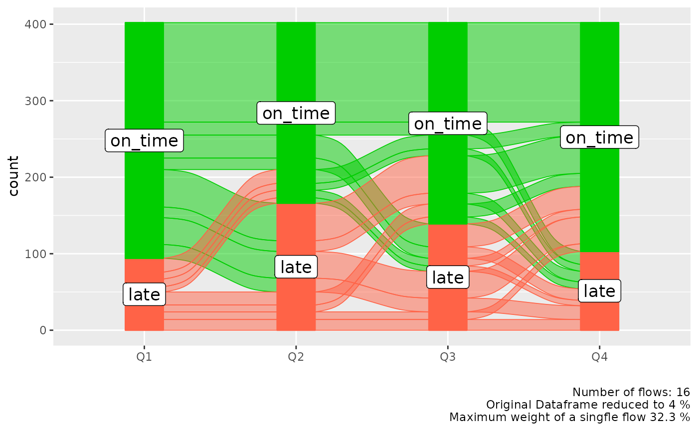

We might be more interested which airline carrier had the most late
flights, we can add it as an additional variable to the plot and use it
for coloring. We can place this variable either on the left or on the
right.

``` r

p_right = alluvial_long(data_long
              , key = qu
              , value = mean_arr_delay
              , id = flight_id 
              , fill = carrier
              , fill_by = 'last_variable'
              , fill_right = T # Default
              ) +
  labs(title = 'Color fill variable placed to the right')


p_left = alluvial_long(data_long
              , key = qu
              , value = mean_arr_delay
              , id = flight_id 
              , fill = carrier
              , fill_by = 'last_variable'
              , fill_right = F
              ) +
  labs(title = 'Color fill variable placed to the left'
       , caption = '\n\n')


gridExtra::grid.arrange( p_left, p_right, nrow = 1)
```

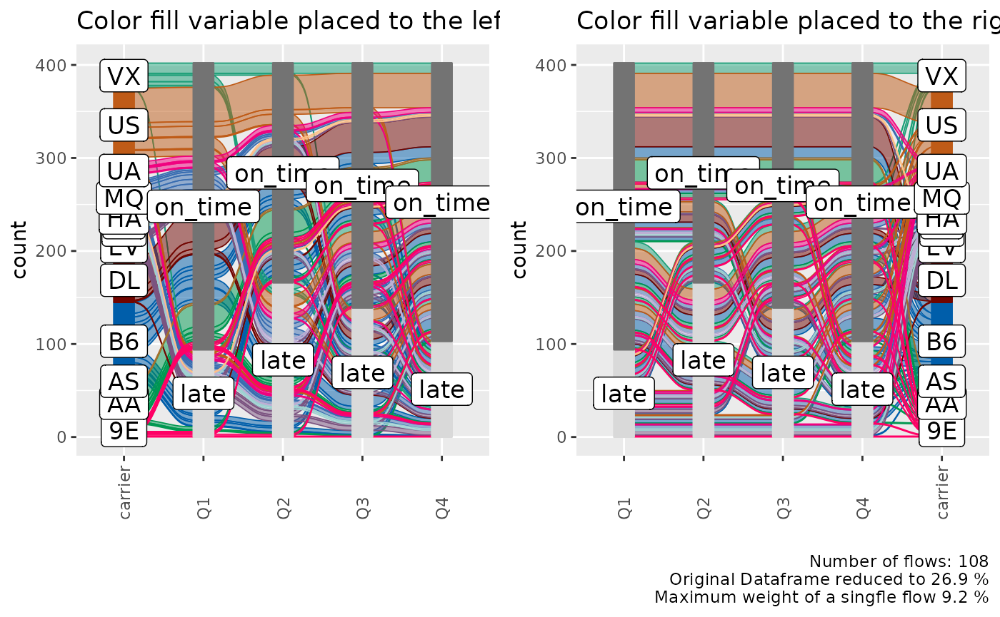

#### Order Levels

[`alluvial_long()`](https://erblast.github.io/easyalluvial/reference/alluvial_long.md)
takes three different `order_levels_*` arguments, one for the keys
(x-axis) one for the values (y-axis) and one for the fill variable. Here
we want to demonstrate how to order the `carrier` variable by number of
flights.

``` r

carriers_ordered_by_count = data_long %>%
  group_by(carrier) %>%
  count() %>%
  arrange( n ) %>%
  .[['carrier']]

alluvial_long(data_long
              , key = qu
              , value = mean_arr_delay
              , id = flight_id 
              , fill = carrier
              , fill_by = 'last_variable'
              , order_levels_fill = carriers_ordered_by_count
              , fill_right = F
              ) +
  labs(title = 'Carriers ordered by number of flights')
```

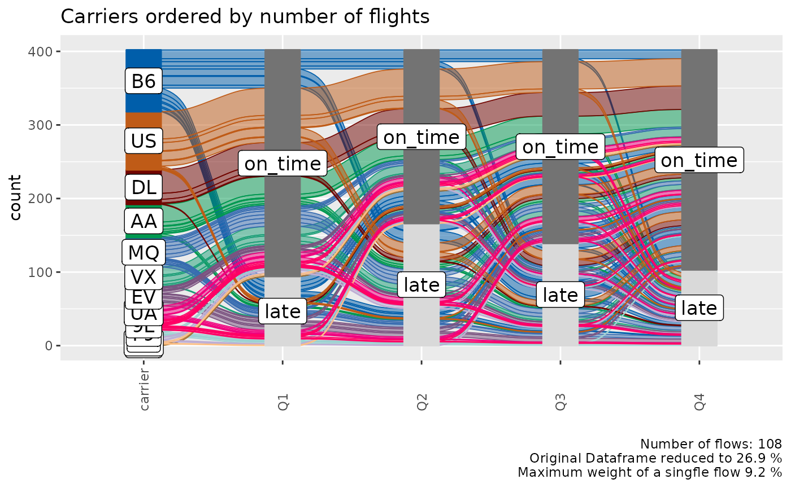

## General

### Missing Data

Explicitly and implicitly missing data will automatically be labeled as
`'NA'` and added as a level. The order of that level can be changed like
any other. We will automatically generate implicitly missing data if we
sample only a fraction of our long format dataframe, because then not
every flight_id will have a value (late, on_time) assigned for each time
point (Q1, Q2, Q3, Q4). We can replace `'NA'` with any other string.

``` r

col_vector = c( 'tomato', 'grey', 'green3')

data_na = data_long %>%
  select(flight_id, qu, mean_arr_delay) %>%
  sample_frac(0.9)

alluvial_long(data_na
              , key = qu
              , value = mean_arr_delay
              , id = flight_id
              , fill_by = 'value'
              , NA_label = 'None'
              , col_vector_value = col_vector
              , col_vector_flow = col_vector
              ) +
  labs(title = 'Implicit NA values')
```

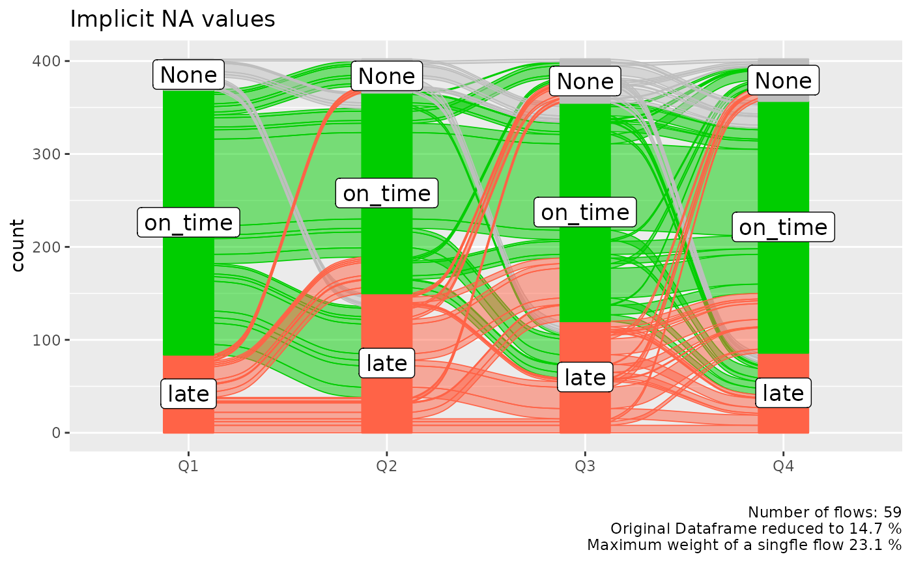

### Colors

[`alluvial_wide()`](https://erblast.github.io/easyalluvial/reference/alluvial_wide.md)
and `alluvial_long` take any sequence of either HEX code or string color
values. `easyalluvial` offers some convenience functions around
constructing qualitative color palettes for distinct values.

``` r

palette_qualitative() %>%
  palette_filter(greys = F) %>%
  palette_plot_rgp()
```

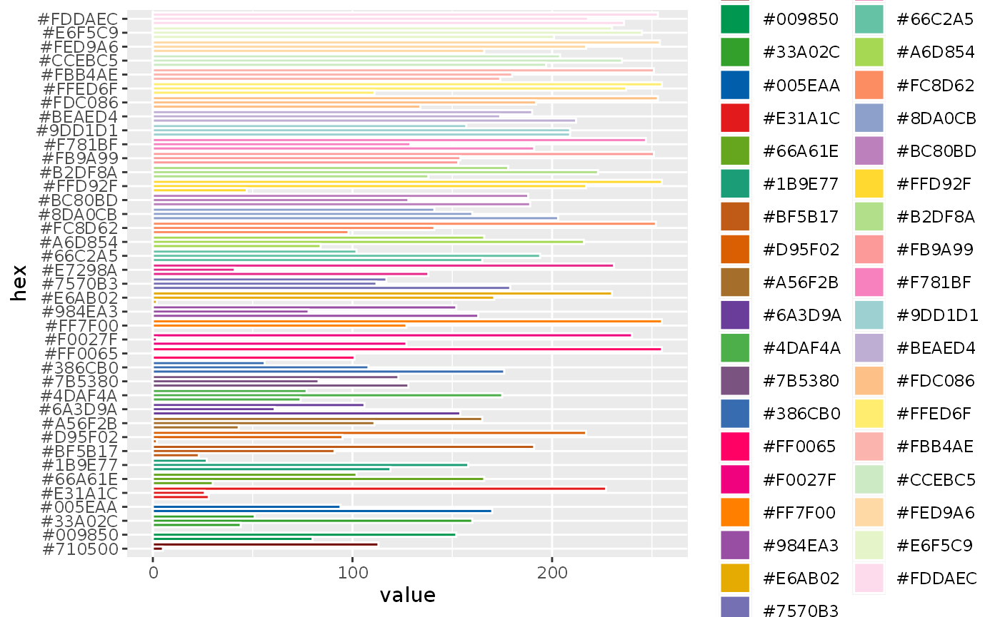

### Connect Flows to observations in original data

We might recognise interesting patterns in the alluvial plot that we
want to follow up upon. For example which cars With medium-low `mpg` and
8 `cyl` and 0 `vs` has an `am` value of 1. Note that we are passing the
`car_id` variable.

``` r

p = alluvial_wide( select(data_wide, mpg, cyl, vs, am, car_id)
                   , id = car_id
                   , fill_by = 'first_variable'
                   , order_levels = c('8','6','4') )

p
```

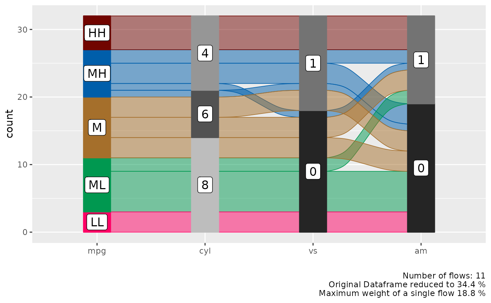

The plot objects returned by both functions have an attribute called
`data_key` which is an x-y table arranged like the alluvial plot one
column containing the original ID. We can use the `car_id` variable to
rejoin the original dataframe.

``` r

attr(p, "data_key") %>%
  filter( mpg == 'ML'
          , cyl == 8
          , vs == 0 
          , am == 1 ) %>%
  # in order to convert factors to integers we have to convert them
  # to character first. Converting from factor returns the order of
  # the factor instead.
  mutate( car_id = as.character(car_id)
          , car_id = as.integer(car_id) ) %>%
  left_join(data_wide, by = 'car_id') %>%
  knitr::kable()
```

| car_id | mpg.x | cyl.x | vs.x | am.x | alluvial_id | n | mpg.y | cyl.y | disp | hp | drat | wt | qsec | vs.y | am.y | gear | carb |
|---:|:---|:---|:---|:---|---:|---:|---:|:---|---:|---:|---:|---:|---:|:---|:---|:---|:---|
| 29 | ML | 8 | 0 | 1 | 11 | 2 | 15.8 | 8 | 351 | 264 | 4.22 | 3.17 | 14.5 | 0 | 1 | 5 | 4 |
| 31 | ML | 8 | 0 | 1 | 11 | 2 | 15.0 | 8 | 301 | 335 | 3.54 | 3.57 | 14.6 | 0 | 1 | 5 | 8 |

### ggplot2 manipulations

thanks to `ggalluvial` the alluvial plots that `easyalluvial` returns
can be manipulated using `ggplot2` syntax

``` r

p + 
  coord_flip() +
  theme_minimal() +
  ggtitle('look at my minimal flip')
```

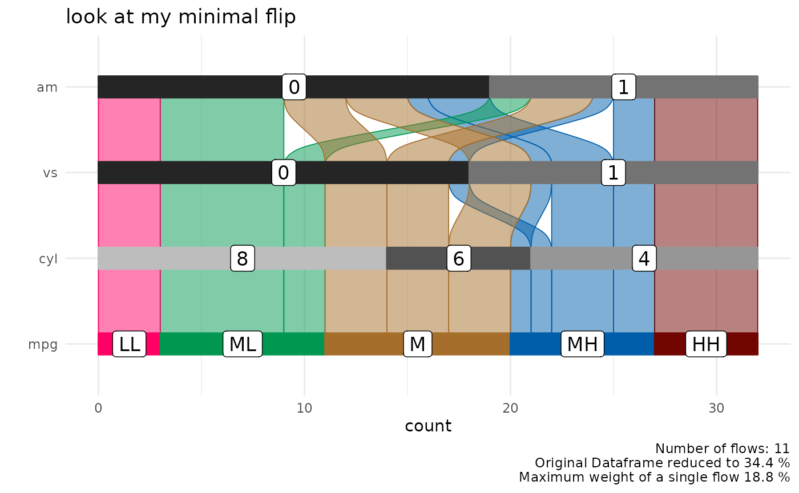
